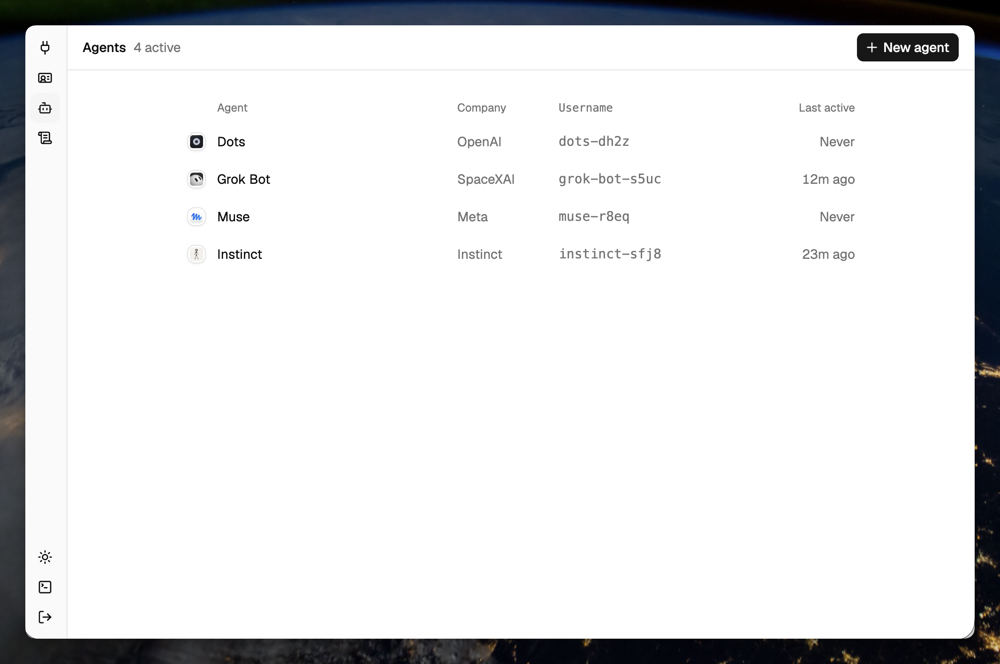
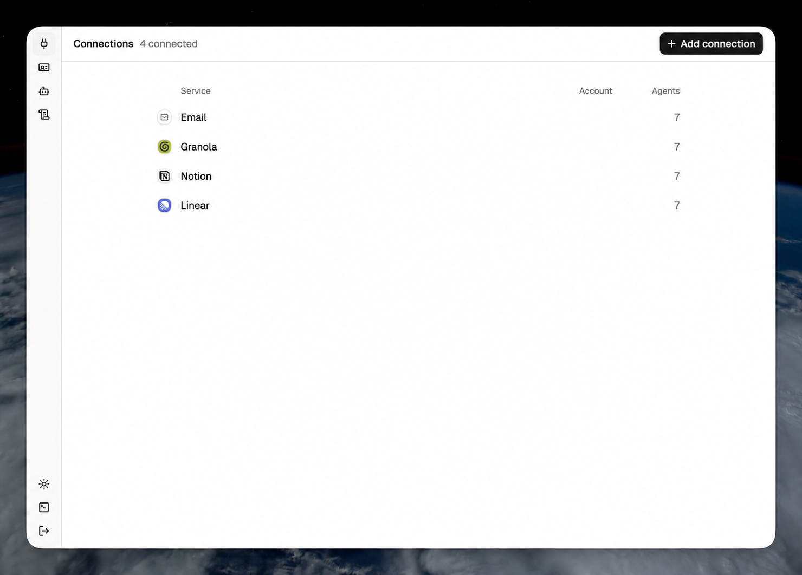
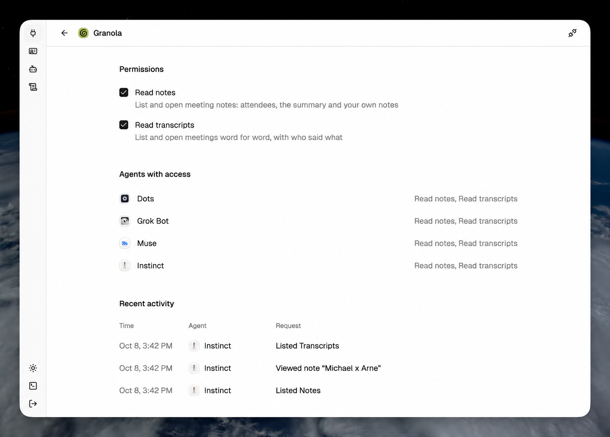

<h1></h1>

  <a href="https://docs.personalagentproxy.com">Docs</a>
  ·
  <a href="https://personalagentproxy.com">Website</a>
  ·
  <a href="CONTRIBUTING.md">Contributing</a>
  ·
  <a href="LICENSE">License</a>

  
  
  

Personal Agent Proxy defines how people can use multiple personal agents without giving every provider
their full private context or silently expanding what an agent may do.

Connect email, Google, Granola, Notion, Linear, Plaid, PostgreSQL, MySQL or any service with an
MCP server. From Home, quick actions can find people, email and files, work with calendars, write
email, calculate, convert units and show balances or spending. Each agent gets its own login and
access. Successful connection actions and actions denied by access settings appear in the activity
log.

<h3 align="center">
  <a href="https://docs.personalagentproxy.com/self-hosting/">Self-host Personal Agent Proxy →</a>
</h3>

<h3 align="center">
  <a href="https://app.personalagentproxy.com">Or use our hosted instance →</a>
</h3>

## Designed to work across

<table align="center" width="75%">
  <tr>
    <td align="center" width="33%">
       
      <strong>Dots</strong>
    </td>
    <td align="center" width="33%">
       
      <strong>Grok Bot</strong>
    </td>
    <td align="center" width="33%">
       
      <strong>Muse</strong>
    </td>
  </tr>
  <tr>
    <td align="center" width="33%">
       
      <strong>Instinct</strong>
    </td>
    <td align="center" width="33%">
       
      <strong>Poke</strong>
    </td>
    <td align="center" width="33%">
       
      <strong>Claude Duet</strong>
    </td>
  </tr>
  <tr>
    <td align="center" width="33%">
       
      <strong>Claude Code</strong>
    </td>
    <td align="center" width="33%">
       
      <strong>ChatGPT</strong>
    </td>
    <td align="center" width="33%">
       
      <strong>Hermes Agent</strong>
    </td>
  </tr>
</table>

  
  &nbsp;
  

