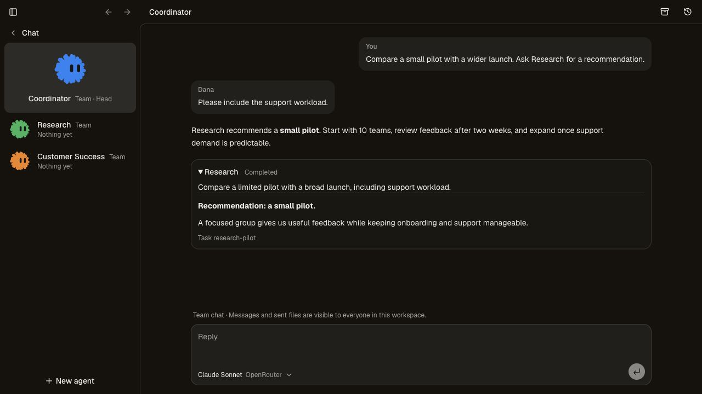

# Shared chats and agent coordination

## Product contract

A team agent is a shared conversation. All current organization members participating in that conversation see the same messages and task state. Personal agents and their histories stay private. A head agent stays pinned above the specialist chats, opens as its own full-width conversation, and can delegate to specialists and consolidate their results there. Team and head-agent chats resume their latest conversation; earlier conversations remain accessible through Conversation history.

Existing shared personas such as General are shared configurations with separate member histories. They must not become shared conversations through a migration. Team conversations are created explicitly; changing a name, provider, model, or coordinator role must never publish existing history.

## UI preview

Rendered from the upstream implementation with synthetic example messages and delegation results.

## Implementation sequence

1. Add an explicit conversation scope, defaulting existing personas to separate member conversations. Add sender identity and a coordinator role. Keep scope immutable after creation.
2. Implement organization-shared conversation access in the database and chat routes. Keep drafts, pending uploads, and read markers per member. Preserve the shared history when its creator leaves or their account is deleted.
3. Make shared execution use only organization-wide connections. Audit model-provider selection, task ownership, alerts, attachments, native Chat access, and authenticated file retrieval as well as script calls: changing the visible message list alone is insufficient.
4. Add durable delegations with an originating thread, initiating member, source and target personas, a child execution, status, and an idempotency key tied to the tool call. Persist results before waking the originating thread.
5. Expose discovery, delegation, status, and cancellation tools through both inline and queued harness execution paths. Allow bounded delegation, reject cycles, and fence mutations using the existing job lease mechanism.
6. Add creation controls for personal versus team conversations and specialist versus head agent. Attribute human messages and delegated results, link the work, and distinguish working, completed, failed, and cancelled delegation states.
7. Verify database migration, authorization, concurrent creation, isolated drafts/read markers, delegation recovery, UI, typecheck, tests, lint, and build. Open the PR with the ticket linked. Verify deployment separately if released.

## Access boundaries

- A private coordinator may delegate to its owner's private specialists or accessible team specialists. Delegation carries only the explicit task and necessary supplied context, never another agent's historical conversation.
- A shared coordinator may delegate only to shared specialists, executing with shared resources. It must not invoke a private specialist and publish that specialist's private output to the team.
- A private request to a team specialist must not silently appear in the team's public history. Its child execution and result retain the initiating conversation's audience.
- Access is checked at execution and delivery, including membership revocation, rather than only when a delegation is created.
- Attachments require an audience-compatible authorization path; a private drive capability must not become readable by the team merely because it was attached.
- Client-supplied sender identity, scope changes, target IDs, and parent IDs are untrusted.

## Existing integration points

- `packages/db/src/harness.ts`: member roots, drafts/read markers, thread opening and access, execution identity, transcript and queued jobs.
- `packages/api/src/harness/route.ts`: persona visibility/management and chat route authorization.
- `packages/api/src/harness/thread-rules.ts`: task identity and queued tool planning.
- `packages/api/src/harness/tool-surface.ts`: inline tools; the queued path must have identical behavior.
- `packages/db/src/chat.ts`: native Chat connection retrieval, which needs the same isolation guarantees as the UI.
- `packages/web/src/components/persona-dialog.tsx`: explicit creation choices.

## Required regression cases

- Existing General histories remain separate after migration.
- Two members observe the same team messages with correct sender identity and task status.
- Draft text, unsent files, and read progress never cross members.
- A personal or cross-organization thread cannot be read through a team route or native Chat connection.
- Shared execution cannot use the author's private connections, private provider credentials, vault, or attachment capabilities.
- Removing a member revokes access without deleting everyone else's conversation.
- Duplicate/retried tool calls create one delegation; stale workers cannot deliver duplicate results.
- Failed, cancelled, cyclic, and over-budget delegations terminate predictably and report their outcome to the originating chat.

## Implemented behavior

The database stores explicit immutable conversation scope, per-member roots for drafts/read markers, and shared task threads without member ownership. Existing histories remain private. Sender snapshots survive author deletion. Shared execution uses organization resources, and team personas cannot choose personal Claude credentials.

Sending a file validates every reference before publishing immutable copies in an organization-owner-managed Team chat files connection. Uploads and source drives stay private; published copies survive the sending member's deletion.

Delegations have durable child executions and a result outbox. Retries reuse the same source-call handoff. The root task allows eight delegated tasks, three levels, and an inherited ten-minute deadline. Cycles are rejected. Cancellation fences jobs, closes tasks, and removes child alerts throughout the active subtree. Completion wakes the coordinator once; it keeps its parent task open while awaiting results.

Private requests to team specialists execute only with shared resources while retaining private task/activity/alert audiences. Execution and delivery recheck membership and target access. Child work is excluded from ordinary specialist chat lists. Both inline and queued harness tools expose discovery, delegation, status, and cancellation. Head-agent instructions coordinate specialists and consolidate results. The originating thread displays expandable status/result cards. Users can request cancellation in the conversation.

## Validation

- Full package test suite, typecheck, lint and production build.
- Fresh database migration and integration coverage for shared messages, private drafts/read markers, legacy isolation, author deletion, attachment retention, delegation retries, stale workers, completion delivery, cancellation, depth/budget limits and access revocation.
- Deterministic shared coordinator/specialist execution through completion and wake-up.
- Local rendered desktop and 390px-wide review of sender alignment, delegation cards and agent creation, using synthetic fixtures.
- Live provider inference and production deployment are separate from these deterministic checks.

This feature does not automatically migrate existing agents to shared conversations.
